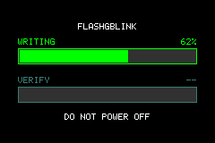
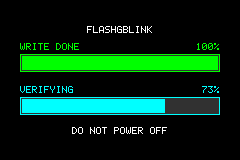
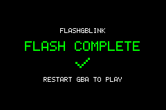

# FlashGBLink — a FlashGBX plugin for reading and flashing carts using your GBA

**Read and flash supported Game Boy Advance cartridges without removing them
from the console.** Connect a Raspberry Pi Pico to your GBA's link port and use
the [FlashGBX](https://github.com/Lesserkuma/FlashGBX) desktop app for cartridge
detection, ROM and save backups, and verified writes. A standalone CLI is
available for scripting.

| Writing | Verifying | Finished |
|:---:|:---:|:---:|
|  |  |  |

No dedicated cartridge reader/writer needed—and no moving the cart between
devices. A small payload boots into GBA RAM over the BIOS multiboot link, then
bridges the Pico to the cartridge. During a write, the console shows live green
write and cyan verification progress, then a completion screen.

> **Experimental performance branch (plugin `0.3.0b1`).** This line paces the
> link port by the GBA's SO ready line instead of a fixed per-word delay. On the
> tested 32 MiB cartridge it reads 3.6× faster and does a verified 4 MiB write
> 2.7–2.8× faster than the `main` release (see
> [`docs/hardware-baseline.md`](docs/hardware-baseline.md)). It needs the
> matching `gbasend` from
> [tanweiken/gbasend-rs](https://github.com/tanweiken/gbasend-rs) commit
> `a1257e4`, and the UF2 images in `firmware/` are built from that commit —
> payload, plugin and firmware must come from this branch together. `main`
> stays on the 0.2.2 release for the upstream-compatible setup.

## Credits

FlashGBLink is mostly glue around two excellent upstream projects. Without them
there would be no link and no cartridge knowledge:

- **[FlashGBX](https://github.com/Lesserkuma/FlashGBX)** by **Lesserkuma**
  (GPL-3.0-or-later) — the desktop application, flashcart profile database,
  cartridge detection, CFI decoding, the `LK_Device`/`Flashcart` device model,
  save-type handling and the GUI. `flashgblink/` implements its AGB device
  interface, and the CLI reads FlashGBX's installed profile database; only the
  four small profiles under `tests/fixtures/` are copied for the tests. If you use
  the GUI or rely on its profile database, that is Lesserkuma's work.
- **[gbasend-rs](https://github.com/nullstalgia/gbasend-rs)** by **nullstalgia**
  (MIT OR Apache-2.0) — the RP2040 firmware, the USB↔SPI bridge, the multiboot
  upload protocol and the `gbasend` CLI. The prebuilt UF2s in `firmware/` are
  built from
  [tanweiken/gbasend-rs](https://github.com/tanweiken/gbasend-rs) commit
  `a1257e4`, a fork of that project which adds the SO ready-line handshake. The
  entire Pico/link/upload layer is theirs.

This project adds the GBA-side payload (16-bit and byte-wide cartridge access,
the profile-driven write-template engine, the two progress bars and the soft
reset), the FlashGBLink device adapter, the `flash.py` CLI with its delta image
writer, and the hardware documentation and validation. The original code and
tests here are roughly 3.8k lines; the value of the project depends heavily on
the two upstream projects above.

Special thanks to **akouzoukos**, developer of
[Apotris](https://github.com/akouzoukos/apotris), for the game used as the
4 MiB image that validated the full write and read-back path.

## Get started

### What you need

- A Game Boy Advance or GBA SP and the cartridge you want to read or write.
- An **RP2040 Raspberry Pi Pico** (not Pico 2 / RP2350) and link-port wiring.
- A computer with USB and
  [FlashGBX 5.2.1 or newer](https://github.com/Lesserkuma/FlashGBX).
- Rust/Cargo to build the `gbasend` USB-to-link transport. The plugin release
  includes the GBA payload, so you do not need a GBA compiler for a normal
  release install.

The Pico is powered by USB. **Do not connect USB power to the GBA link-port
VCC.** Wiring: Pico GP0 → GBA SO, GP2 → GBA SC, GP3 → GBA SI, and GND, with a
1 kΩ series resistor as described in
[gbasend-rs DIY wiring](https://github.com/nullstalgia/gbasend-rs).

### Install once

1. **Flash the Pico.** Hold **BOOTSEL** while plugging it into USB, then copy
   [`firmware/gbasend-pico.uf2`](firmware/gbasend-pico.uf2) to the mounted
   `RPI-RP2` drive. It reboots as USB device `2E8A:000A`. See
   [`firmware/README.md`](firmware/README.md) for firmware provenance and
   checksums.

2. **Install the FlashGBLink plugin.** Download
   [`FlashGBLink-plugin.zip`](https://github.com/tanweiken/FlashGBLink/releases)
   from Releases and extract it into FlashGBX's `plugins/` directory. Common
   locations and manual install instructions are in
   [plugin installation details](#plugin-installation-details). Start FlashGBX
   and approve **FlashGBLink** when prompted. The plugin archive already
   includes the GBA payload.

3. **Build `gbasend`.** The plugin uses this small Rust command-line tool to
   upload the payload to the GBA over USB and the Pico. It is not bundled in the
   plugin archive; build the fork this branch is validated against, once:

   ```sh
   git clone https://github.com/tanweiken/gbasend-rs
   git -C gbasend-rs checkout a1257e4
   cargo build --release --manifest-path gbasend-rs/gbasend-cli/Cargo.toml
   GBASEND="$PWD/gbasend-rs/gbasend-cli/target/release/gbasend"
   ```

   The fork is `<https://github.com/tanweiken/gbasend-rs>` — upstream's
   `nullstalgia/gbasend-rs` does not carry the SO handshake, so its nootloader
   and speed test do not match the firmware in `firmware/`.

   Configure the plugin to find the resulting executable using `PATH`,
   `FLASHGBLINK_GBASEND`, or `FlashGBLinkGbasend` in FlashGBX's `settings.ini`.
   The plugin auto-upload runs when you connect.

### Connect and use

1. Insert the cartridge and turn the GBA off.
2. Hold **START + SELECT** while powering it on. This makes the GBA BIOS wait
   for the Pico's multiboot upload.
3. In FlashGBX, choose **Connect → FlashGBLink**. The plugin uploads the payload
   and connects automatically when `gbasend` is available.
4. Use FlashGBX to detect the cartridge, back up its ROM/save, or write a ROM.
   The GBA displays progress during writes and verification.

The START + SELECT hold is needed each time the GBA is powered on for a new
session. The payload stays in RAM until reset or power-off. If automatic upload
is unavailable, use the CLI uploader described below.

### Installing from a source checkout

If you prefer to install directly from the repository, first clone it and
enter the checkout:

```sh
git clone https://github.com/tanweiken/FlashGBLink.git
cd FlashGBLink
```

Build the GBA payload (requires `arm-none-eabi-gcc` and Python 3), then install
the host dependencies and plugin:

```sh
make -C payload
python3 -m venv .venv
.venv/bin/pip install pyserial FlashGBX
.venv/bin/python3 scripts/install_plugin.py --gbasend /path/to/gbasend
```

The installer detects FlashGBX's plugin directory on macOS, Linux, and Windows.
To preview its destination or choose a directory manually:

```sh
.venv/bin/python3 scripts/install_plugin.py --dry-run
.venv/bin/python3 scripts/install_plugin.py --plugins-dir "/path/to/plugins"
```

Typical plugin locations are `~/.config/FlashGBX/plugins` on Linux,
`~/Library/Preferences/FlashGBX/plugins` on macOS, or
`%LOCALAPPDATA%\FlashGBX\plugins` on Windows. For a local checkout, you can
also set `FLASHGBLINK_ROOT` to its path. The `--uninstall` option removes an
existing installation.

### If the GBA does not connect

Check that the Pico enumerates as `2E8A:000A`, that the wiring and common ground
are correct, and that the GBA was powered on with **START + SELECT** held. To
check the host setup and plugin, run:

```sh
.venv/bin/python3 flash.py doctor --gbasend "$GBASEND"
```

The GBA BIOS only listens for multiboot at power-on; the link port has no reset
or boot-mode line. FlashGBLink automates the upload, but cannot remove that
button hold on stock hardware.

## Command-line use

The CLI uses the same payload and does not need the plugin, but it does use
FlashGBX's installed profile database and `Flashcart`/`CFI` classes. The manual
upload there is also the fallback when the plugin's auto-upload is unavailable:

> **Caution:** raw `erase`, `program`, and `restore` commands modify cartridge
> data. Back up the ROM and save first. For routine ROM updates, `image` verifies
> the written data by default.

For CLI use, install Python 3, `pyserial`, and FlashGBX in a virtual environment:

```sh
python3 -m venv .venv
.venv/bin/pip install pyserial FlashGBX
```

```sh
PY=.venv/bin/python3

$PY flash.py upload --gbasend $GBASEND       # payload, ~2 s
$PY flash.py detect                          # ID, profile, CFI, sectors
$PY flash.py id                              # 20 00 0E 88 ...
$PY flash.py cfi                             # 32 MiB, 1.7-2.0 V, RQZ swap
$PY flash.py profiles                        # list FlashGBX's profiles
```

To skip autodetection (or to use a cartridge with no matching ID), pass any name
from a profile:

```sh
$PY flash.py image Apotris.gba --profile "2006-36-71_V2 with M36L0R8060B"
$PY flash.py image Apotris.gba --config /path/to/FlashGBX/config
```

The payload stays resident, so these need no further button presses:

```sh
$PY flash.py read 0 0x100 rom-head.bin
$PY flash.py erase 0x1F00000
$PY flash.py program 0x1F00000 0xBEEF
$PY flash.py seq 0:0x50 0:0xFF
$PY flash.py image Apotris.gba --boot
$PY flash.py save apotris.sav
$PY flash.py restore apotris.sav
$PY flash.py boot
```

`image` writes a `.gba` file, erasing only changed sectors from the detected
profile's sector map (128 KiB sectors on the M36):

```sh
# First time, or after erasing the cartridge with another tool:
$PY flash.py image Apotris.gba --full --boot

# Later runs: only changed sectors are touched.
$PY flash.py image Apotris.gba --boot
```

- The image is padded with `0xFF` to the end of its last sector; matching
  sectors are skipped.
- The payload has a CRC32 command, so the diff compares sectors on the
  cartridge bus: 4 MiB takes about 20 seconds instead of the 2.5 minutes a
  read-back over the link takes. Sector verification uses the same command, so
  a verified write only reads ROM data back if a CRC disagrees.
- A small state file records the last verified CRC32 of every sector plus a
  probe of each sector, so a repeat run skips even the CRC scan (~1 s). It is
  stored per profile and sector map under `~/.cache/flashgblink/delta/`;
  `--state FILE` or `FLASHGBLINK_STATE_DIR` change that. If the probes show the
  cartridge changed outside the tool, every sector is checked again. `--full`
  rewrites everything without checking; `--no-verify` skips the read-back and
  records no state.
- Each changed sector is erased, programmed in 4 KiB blocks using the profile's
  buffered-write template, and verified.

Options: `--port`, `--baud` (data phase SPI clock, default 1.25 MHz),
`--upload-baud` (multiboot clock, default 256 kHz), `--config` (profile
directory; default: autodetect FlashGBX's), `--profile` (profile name,
skips autodetection), `--state` (delta state file),
`FLASHGBLINK_CONFIG` (profile directory override),
`--gbasend`, `--payload`, `--verbose`.

## Saves

`save` dumps the save media at `0x0E000000` to a raw `.sav` that emulators can
open; `restore` writes one back and reads it to confirm. Both take
`--size BYTES` for a different save media size (default `0x10000`, 64 KiB).

```sh
$PY flash.py save apotris.sav
$PY flash.py restore apotris.sav            # verified
$PY flash.py restore old.sav --no-verify
```

The save bus is 8 bits wide, so the payload has byte-wide reads and writes
(`0x5A70`/`0x5A80`) separate from the 16-bit cartridge path. A 16-bit load from
that region returns the same byte in both halves of the lane, which silently
doubles every byte and produces a `.sav` no emulator can read.

Back up before flashing: `image --full` erases the whole cartridge image area,
and a save that was never dumped is gone.

## How it works

- **Pico firmware** (`gbasend-pico`) bridges USB serial to the GBA link port and
  paces each word by the GBA's SO line, so a transfer costs only as long as the
  GBA's own work rather than a fixed per-word delay.
- **Payload** (`payload/`) runs in GBA RAM after multiboot, performs 16-bit
  cartridge stores/loads, byte-wide save access, a CRC32 over cartridge bytes
  for diffing and verification, the progress bars and a soft reset, and holds
  the profile's write template. Before booting the cartridge it resets the I/O
  registers left over from multiboot (keypad IRQ, SIO, timers, DMA) so the game
  starts as it would after a hard reset.
- **FlashGBLink plugin** (`flashgblink/`) implements the AGB-relevant subset of
  FlashGBX's device protocol on top of `flashgblink/gbalink/`, so FlashGBX's `LK_Device`,
  `Flashcart` and profile database run unchanged.
- **CLI** (`flash.py`) uses the same `flashgblink/gbalink/` transport and FlashGBX's
  `Flashcart`/CFI for detection, plus a delta image writer.

## Additional limitations

- AGB cartridges only.
- EEPROM and save-flash writes are not implemented.
- Profiles that require a cartridge power cycle abort with a prompt; power the
  GBA off and on holding START+SELECT, re-upload the payload and reconnect.
- FlashGBX erases every sector in the image unless **Skip writing matching ROM
  chunks** is enabled (Config menu). The payload's CRC32 command makes that
  compare cheap; the GUI setting defaults to off. The state-file fast path is
  only in `flash.py image`.
- The on-screen progress bars and `flash.py boot` are wired through the CLI;
  FlashGBLink shows both bars during a FlashGBX write, but booting after a write
  is still a CLI action.
- Cartridges over 32 MiB that need flash bank switching, and the encrypted or
  bus-specific profiles (3D Memory, GBAMP, Sintax, Vast Fame), are not supported.

## Hardware compatibility and performance

- **Hardware-tested:** the bootleg 32 MiB `M36L0R8060B` cartridge using the
  FlashGBX profile `2006-36-71_V2 with M36L0R8060B`. Detection, ROM reads,
  erase/program, full-image writes with verification, boot, and 64 KiB SRAM
  backup/restore have been exercised on hardware.
- **Other profiles:** the payload is designed to execute FlashGBX profile write
  sequences, but other cartridge models have not yet been validated on real
  hardware. Detection alone does not guarantee that a cartridge is safe to
  write.
Measured with a 4 MiB Apotris image on the tested cartridge after the SO
flow-control change: a verified full write took **2:13** from the CLI and
**2:22** through FlashGBX (was 6–7 minutes), a full read **45 s** (was about
2.5 minutes), and 64 KiB SRAM backup/verified restore were not re-measured
(2.6 / 6.8 seconds before). A repeat write of an unchanged image is a probe of
every sector and takes about a second; a changed image only erases, programs
and CRC-verifies the sectors that differ. Actual times depend on the cartridge
and operation.

The bundled payload and Pico firmware pace each word by the GBA's SO line
instead of a fixed delay, and the host no longer waits for the serial write to
drain. That took the link from a fixed 150 µs per word to about 43 µs on this
setup: 3.6× on reads and 2.7× on a full verified write. The handshake only
engages at or above 1 Mbaud; slower sessions, the BIOS multiboot phase and an
older payload all keep the fixed delay, so mixed installs stay safe. See
`docs/hardware-baseline.md` for the measurements and how they were taken.

## Word protocol

All traffic is 32-bit words, MSB-first. The host sends a word and receives one
back; the payload preloads its reply, so a reply to a command word is the
previous status. Addresses below `0x08000000` are relative to the cartridge
base; anything else is used as-is, which is how save memory at `0x0E000000` is
reached with the same commands.

| Word | Meaning |
|---|---|
| `0x5A5A5A5A` | ping; reply is the current status |
| `0x5A20nn` | write `nn` address/value pairs (two words per pair) |
| `0x5A3000` | read: next words are address and count, then `count` dummies |
| `0x5A5000` | write block: next words are address and packed word count, then data |
| `0x5AB000` | CRC32 job: next words are address and byte count; poll with pings until OK, then read the result |
| `0x5AB100` | CRC32 result: next word is a dummy; its reply is the last job's CRC32 |
| `0x5A0060nn` / `0x5A0160nn` | draw `nn`% on the write (green) / verify (cyan) bar |
| `0x5AA000` | show the FLASH COMPLETE / RESTART GBA TO PLAY screen |
| `0x5A7000` | read bytes: next words are address and byte count, then dummies |
| `0x5A8000` | write bytes: next words are address and byte count, then packed data |
| `0x5A40nn` | soft reset into the cartridge |
| `0x5A9000` | install a write template: chunk bytes, command count, then 4 words per command |
| `0xA5A50000` | OK |
| `0xA5A50001` | busy (drawing); retry the poll |
| `0xA5A500E1` | rejected command |

## Cartridge notes

The M36 tracks Intel command state per 8 MiB bank. The reset (`0x50`, `0xFF`)
must be issued at an address inside the bank being erased or programmed,
otherwise that bank stays in status-register mode and reads return `0x0080`.
The profile's `reset_every` moves the reset to each bank boundary, and every
sector is reset at its own address before erase and programming.

The buffered-write count field is **bytes minus one** (63 for 64 bytes). The
payload substitutes the profile's `BS` token with the configured write window,
so Intel `E8` and AMD `0x26` profiles share the same code.

Profile wait tables are executed after each command, not only at the end of a
sequence: some parts poll the status register after the first unlock write, and
AMD buffered writes finish with `0x2A` followed by data polling at the buffer
address.

The BIOS soft reset only boots the cartridge when the flag at `0x03007FFA` is
zero; multiboot leaves it non-zero. SWI 00h resets the CPU but not the I/O
registers, so the payload first calls SWI 01h (`RegisterRamReset`, flags
`0xFC`) to clear the keypad, SIO, timer and DMA state left by multiboot. Without
that cleanup, a game can boot after a soft reset but ignore button input until
a hard reset.

## Development

Run the hardware-free tests:

```sh
.venv/bin/python3 -m unittest discover -s tests
```

The suite covers the word protocol, CFI decoding, write-plan encoding, the
FlashGBLink device emulation, FlashGBX `Flashcart` detection through the
adapter, and the progress-bar phase logic.

## Roadmap

- Save backup/restore: the 64 KiB SRAM works; save flash (64/128 KiB, banked)
  and EEPROM (512 B/8 KiB, bit-banged) still to do.
- Flash cartridges that need bank switching (over 32 MiB) and the encrypted or
  bus-specific profiles (3D Memory, GBAMP, Sintax, Vast Fame).
- Improve read/write speed and overall transfer performance.
- Optional Pico firmware with the payload embedded, removing the separate host
  upload step. The FlashGBX plugin already uploads the payload automatically on
  Connect; **START + SELECT** is still required on stock hardware.
- Optional web UI for managing ROM updates over the link.

## License

GPL-3.0-or-later. See `LICENSE` and `NOTICE`.
